# Travel Domino

一个面向 HarmonyOS 的行程规划应用，支持时间线编排、地图选点、AI 辅助输入、冲突消解与到达提醒。

## 项目亮点

- 时间线驱动：围绕 `Plan + Event` 组织行程，支持拖拽/调整与冲突处理。
- 地图联动：集成高德能力，支持地点选取、地理编码与路线相关能力。
- AI 辅助：支持自然语言输入转结构化建议（依赖本地配置的 AI Key）。
- 到达提醒：包含到达提醒引擎与协调器，支持提醒弹窗与流程接续。
- 测试覆盖：包含 `src/test` 与 `src/ohosTest` 测试入口。

## 技术栈

| 维度 | 方案 |
| --- | --- |
| 平台 | HarmonyOS (API 20) |
| 语言 | ArkTS |
| UI | ArkUI |
| 构建 | Hvigor |
| 地图 | AMap Harmony SDK |

## 架构速览

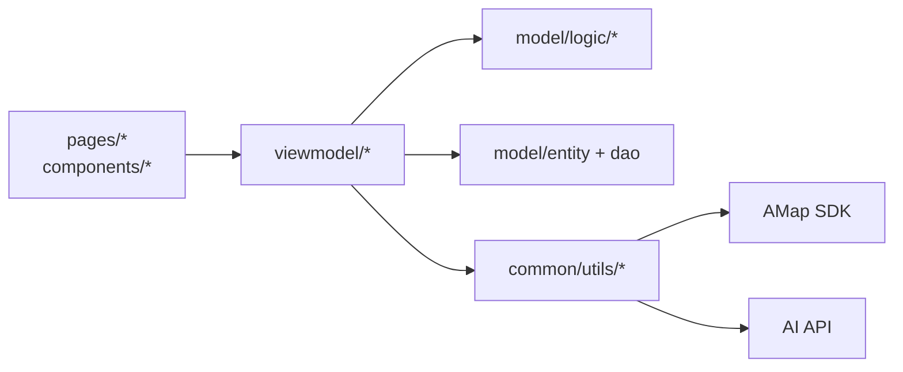

## 目录结构

```text
E:\Travel12.19
├─ AppScope/                     # 应用级配置与资源
├─ entry/
│  ├─ src/main/ets/
│  │  ├─ pages/                  # 页面与组件
│  │  ├─ viewmodel/              # 视图模型与交互编排
│  │  ├─ model/                  # 实体、DAO、业务逻辑
│  │  └─ common/utils/           # 服务与基础能力（含配置模板）
│  ├─ src/test/                  # 单元测试
│  └─ src/ohosTest/              # 设备测试
├─ hvigor*/                      # 构建相关
└─ build-profile.json5           # 构建配置
```

## 快速开始

### 1) 环境准备

- DevEco Studio（推荐最新稳定版）
- HarmonyOS SDK（与项目 `targetSdkVersion 6.0.0(20)` 对齐）

### 2) 配置本地密钥（必做）

1. 复制文件：
   - `entry/src/main/ets/common/utils/AppConfig.example.ets`
2. 重命名为：
   - `entry/src/main/ets/common/utils/AppConfig.ets`
3. 填写你自己的密钥：
   - `AI_API_KEY`
   - `AMAP_WEB_API_KEY`
   - `AMAP_SDK_API_KEY`

> `AppConfig.ets` 已在 `.gitignore` 中，默认不会提交。

### 3) 运行项目

- 方式 A（推荐）：使用 DevEco Studio 打开 `E:\Travel12.19`，选择设备后直接 Run。
- 方式 B（命令行，可选）：在项目根目录执行 `hvigorw.bat` 对应任务进行构建。

## 测试

- 单元测试目录：`entry/src/test`
- 设备测试目录：`entry/src/ohosTest`
- 建议优先在 DevEco Studio 内执行测试任务，便于查看日志与断点。

## 安全说明

- 不要提交任何真实密钥或账号凭据。
- `AppConfig.ets` 为本地私有文件，仅保留 `AppConfig.example.ets` 作为模板。
- 如果密钥已泄露，请立即在服务端轮换。

## 开发建议

- 小步提交，保持 PR 可审查。
- 修改时间/冲突逻辑时，优先补充对应测试。
- 与地图、AI 相关的失败路径要显式处理（超时、空结果、鉴权失败）。

## 项目展示

> 图片来源：`C:\Users\Reaper\Pictures\travel`，已整理并提交到 `docs/showcase/`。


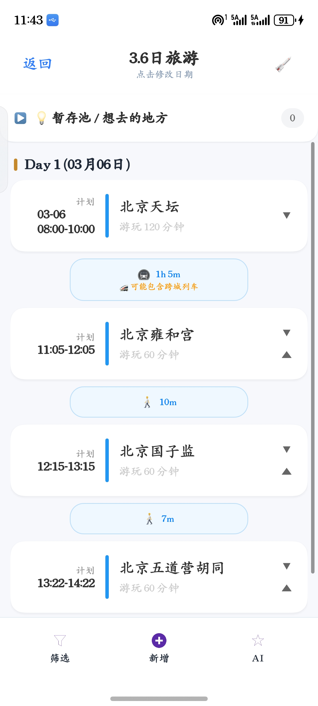


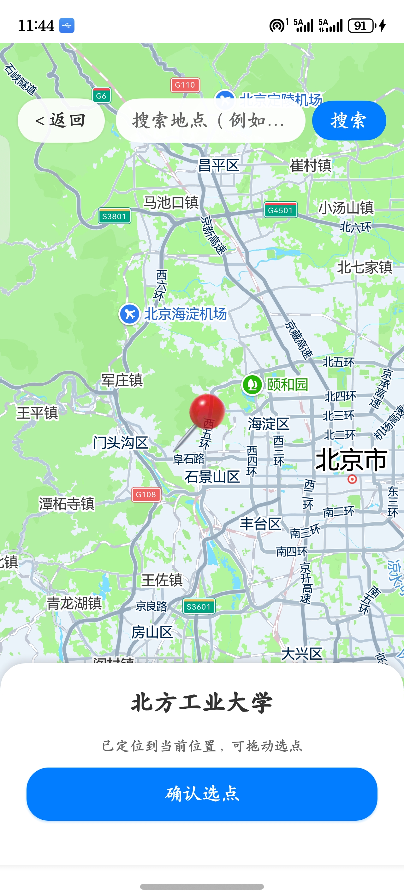
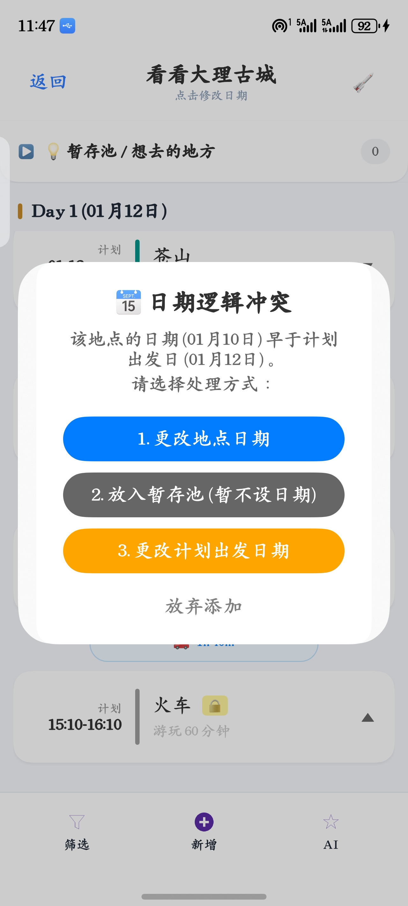
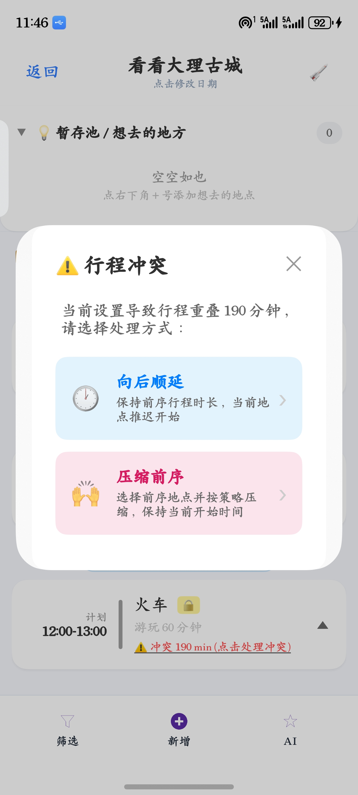

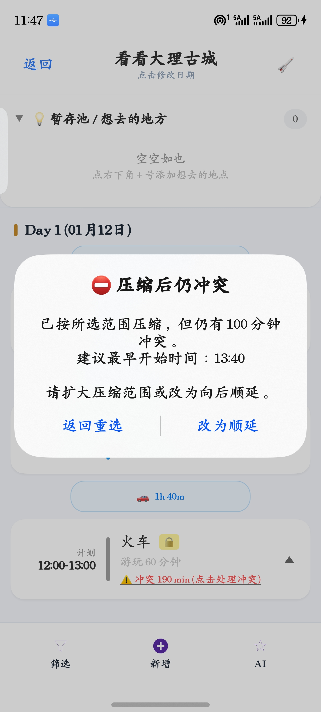
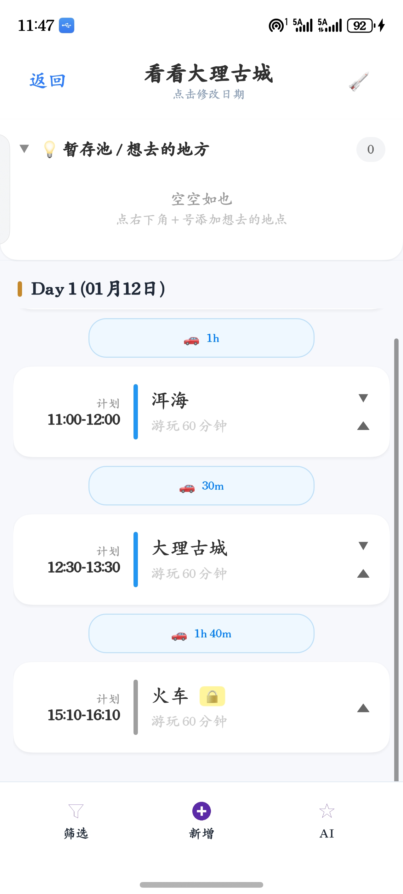
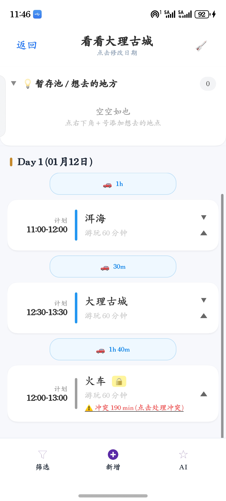


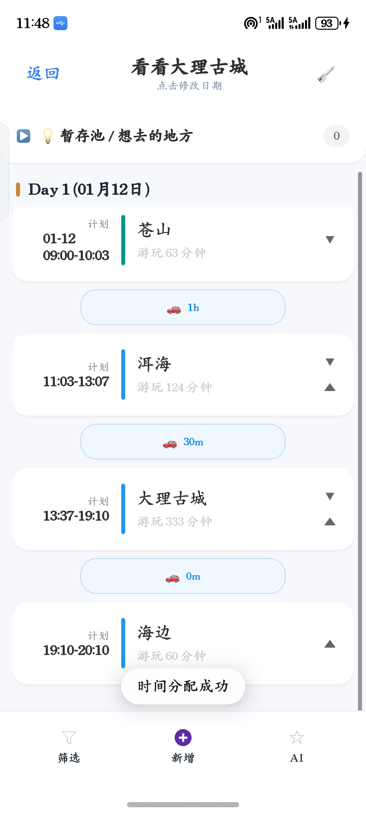
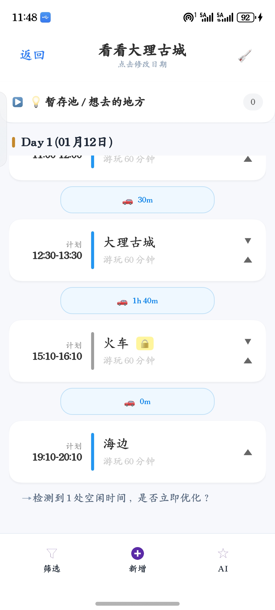
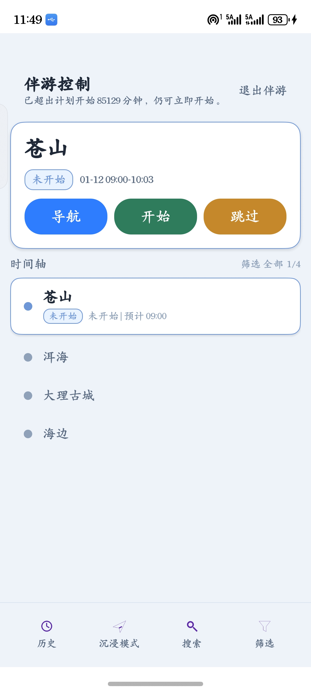


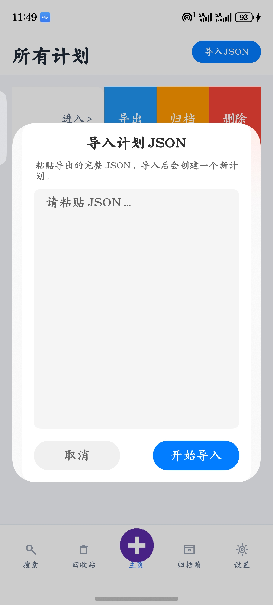


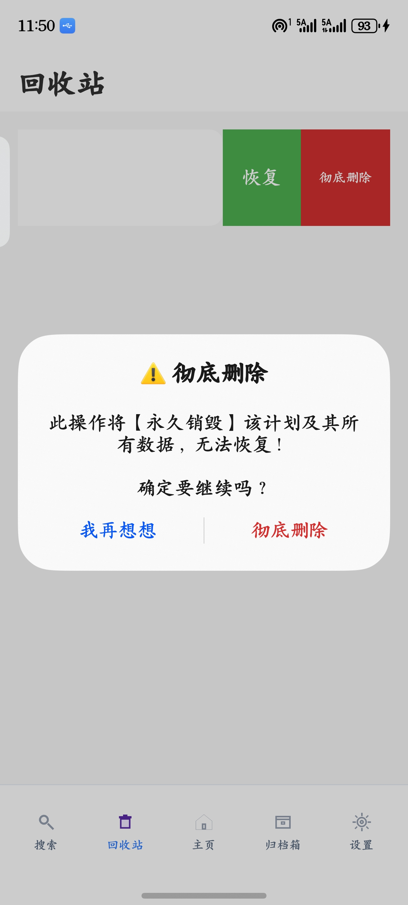


## License

当前仓库未声明开源许可证；如需开源，请先补充 `LICENSE`。
